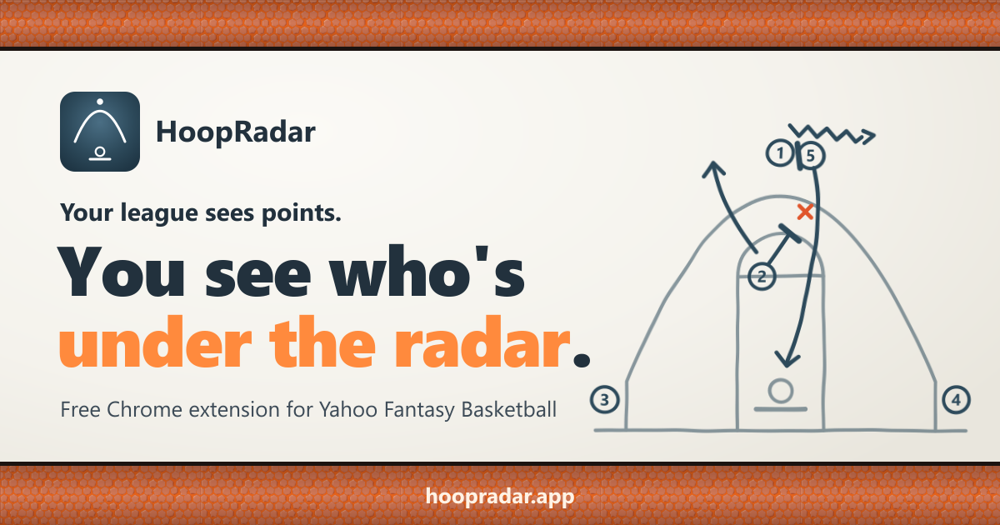
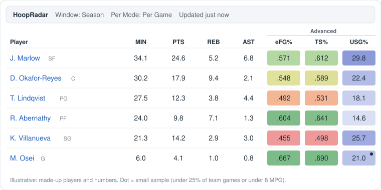
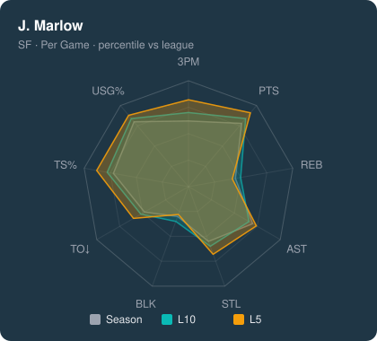

<p align="center">
  <a href="https://hoopradar.app"></a>
</p>

<p align="center">
  <a href="https://github.com/ccc1236/hoopradar/releases/latest"></a>
  
  <a href="LICENSE"></a>
</p>

<p align="center">
  <b><a href="https://github.com/ccc1236/hoopradar/releases/latest">Download</a></b> &nbsp;·&nbsp;
  <a href="https://hoopradar.app">Website</a> &nbsp;·&nbsp;
  <a href="#install">Install</a> &nbsp;·&nbsp;
  <a href="#faq">FAQ</a> &nbsp;·&nbsp;
  <a href="CHANGELOG.md">Changelog</a>
</p>

# HoopRadar

A free Chrome extension that puts advanced stats on Yahoo Fantasy Basketball's **Players** and **My Team** pages: eFG%, TS% and USG% columns, Last 5 / Last 10 game windows, and Per 36 / Per 100 possession modes. Data comes from nba.com/stats.

<p align="center">
  
  
</p>
<p align="center"><sub>Illustrative mock-ups: made-up players and numbers.</sub></p>

## What it does

- **Advanced columns, colour shaded.** eFG%, TS% and USG% appear under an "Advanced" header. eFG% and TS% are shaded from red (poor) through yellow (league average) to green (elite); USG% uses a blue scale, because high usage is a role, not good or bad. Small samples get a dot on the USG% cell.
- **Last 5 / Last 10 games.** Windows count games the player actually played, unlike Yahoo's day-based filter.
- **Per Game, Per 36, Per 100 possessions.** Counting stats (PTS, REB, AST, ST, BLK, 3PTM, TO) rescale; ratios like FG% and TS% stay the same, as they should.
- **Radar card.** Hover a player to compare their Season, L10 and L5 percentiles across nine stats; click to pin it, then click an axis for the stat's rank and league average.

A small filter bar above the table holds Window, Per Mode, Refresh and a status line. HoopRadar replaces the stat values Yahoo displays with nba.com numbers for your chosen window and mode, then re-applies your sort; the page's structure, sorting and pagination are otherwise untouched.

## Install

HoopRadar is not on the Chrome Web Store yet, so it installs as an unpacked extension. It takes about two minutes.

1. Download the latest `hoopradar-vX.Y.Z.zip` from the [releases page](https://github.com/ccc1236/hoopradar/releases).
2. Unzip it somewhere permanent. Chrome loads the extension from that folder every time it starts, so it has to stay put: unzipping into Downloads and tidying up later will break it.
3. Go to `chrome://extensions` and turn on **Developer mode** (top right).
4. Click **Load unpacked** and select the unzipped `hoopradar` folder.

Then open your league's Players or My Team page. Chrome may show a warning about developer-mode extensions; that is expected for extensions installed this way.

Works in Chrome, Edge and Brave on desktop (use `edge://extensions` or `brave://extensions`).

## Updating

There is no auto-update. To hear about new versions, click **Watch > Custom > Releases** at the top of this repo.

To update, unzip the new version over the same folder, then click the reload arrow on the HoopRadar card in `chrome://extensions`.

Keep the same folder. Chrome identifies an unpacked extension by its folder path, so loading a copy from a different place installs a second HoopRadar alongside the first, starting with empty storage (your settings and cached player mapping are lost). Every release unzips to a folder named `hoopradar` so that unzipping over the old one is the natural thing to do.

## FAQ

<details>
<summary><b>Is it free?</b></summary>

Yes. Free and open source under the MIT licence.
</details>

<details>
<summary><b>Does it collect my data?</b></summary>

No. It only requests stats from stats.nba.com. Nothing about you or your league leaves your browser, and there is no analytics or tracking.
</details>

<details>
<summary><b>Which browsers does it work in?</b></summary>

Chromium browsers on desktop: Chrome, Edge and Brave. Not Firefox, Safari or mobile.
</details>

<details>
<summary><b>Why don't the numbers match Yahoo's?</b></summary>

HoopRadar replaces Yahoo's displayed stats with nba.com numbers for the window and mode you pick. Yahoo's own Stats dropdown (Last 7 / 14 / 30 days) still works, but its picks are replaced after the page reloads. The two time concepts differ: Yahoo's filter is days, HoopRadar's is games the player actually appeared in. L5 and L10 are per player: someone who sat out three games gets L5 from their last five appearances.
</details>

<details>
<summary><b>Why don't eFG%, TS% and USG% change when I switch Per Mode?</b></summary>

They are ratios or per-possession rates, so Per Game, Per 36 and Per 100 give the same values (the same goes for FG%, FT% and 3P%). The Window does change them, because the game sample changes.
</details>

<details>
<summary><b>Why is the first load slow?</b></summary>

The first time you pick a Window and Per Mode combination, HoopRadar fetches fresh data from nba.com, which takes a few seconds; requests are deliberately spaced out to stay friendly with nba.com. Data is then cached for about 6 hours, so later views are instant. Opening a player's radar card loads all three windows at once. nba.com is occasionally flaky; HoopRadar retries automatically, and clicking Refresh usually clears a stat that still failed.
</details>

<details>
<summary><b>Does it work on ESPN, Sleeper or other sites?</b></summary>

No. Yahoo Fantasy Basketball only, on the Players and My Team pages.
</details>

<details>
<summary><b>Is it on the Chrome Web Store?</b></summary>

Not yet. Install from GitHub as described above.
</details>

## Development

```bash
npm install
npm test              # run unit tests
npm run typecheck
npm run build         # writes dist/
```

After a code change: `npm run build`, then reload the extension in `chrome://extensions` and hard-refresh any Yahoo tab where you want to see the new build. The landing page lives in [`site/`](site/README.md).

## License

MIT. HoopRadar is an independent project, not affiliated with Yahoo or the NBA.
